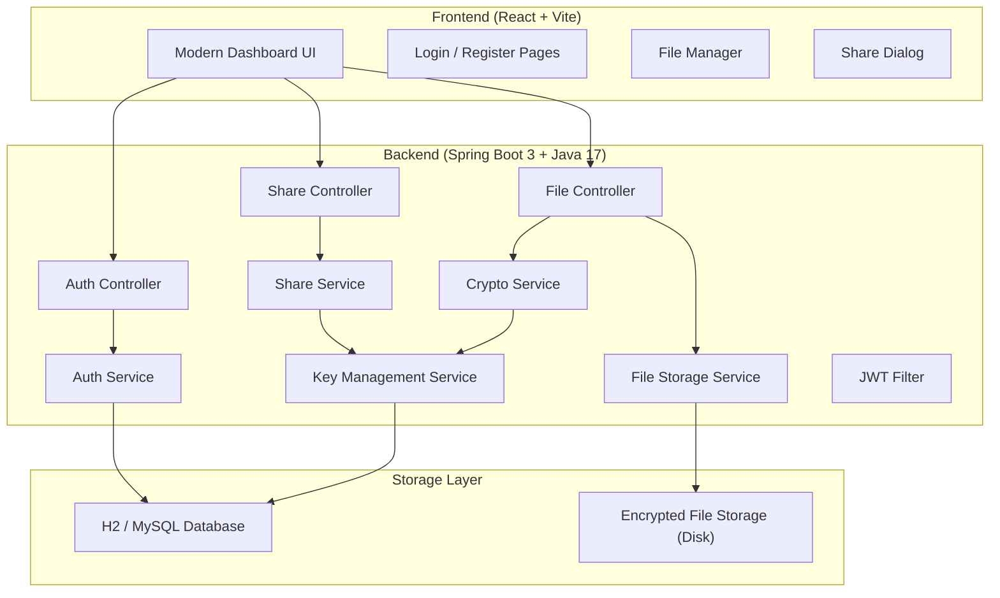
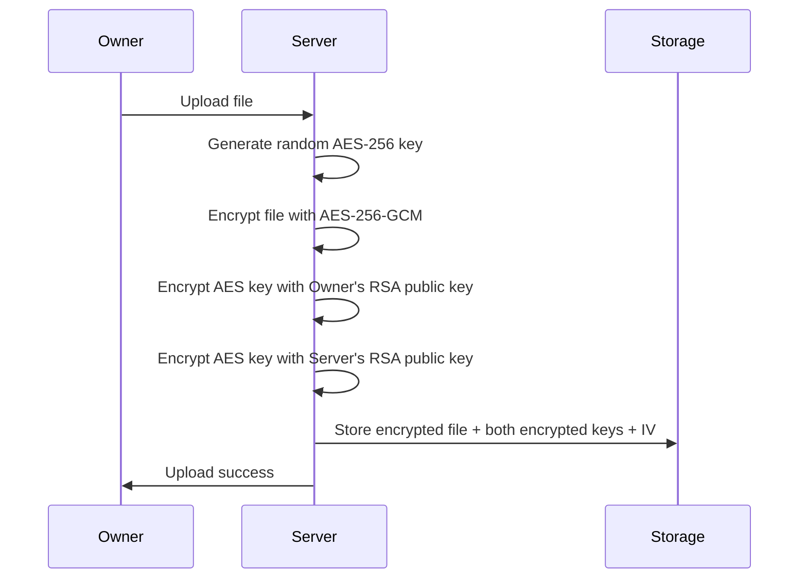
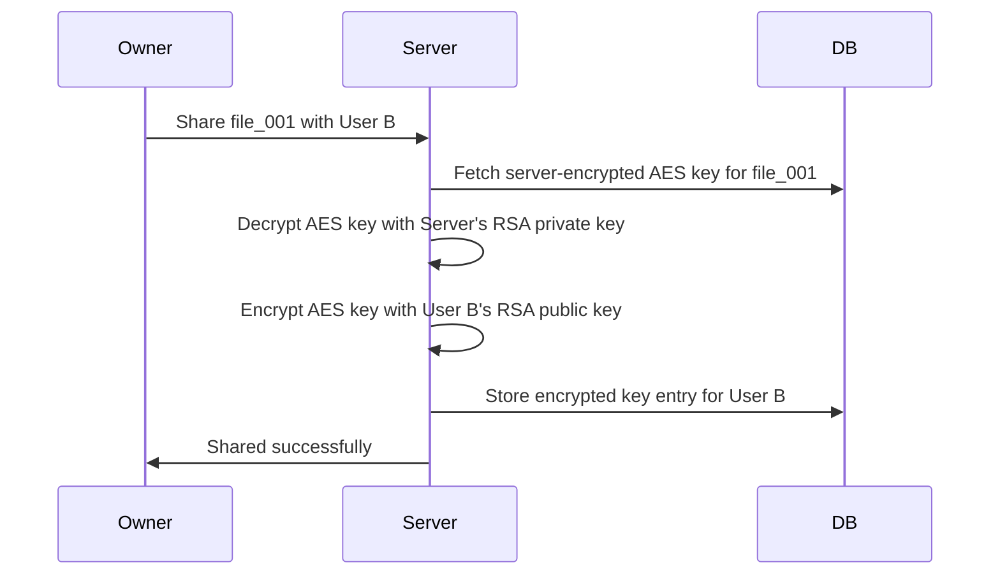
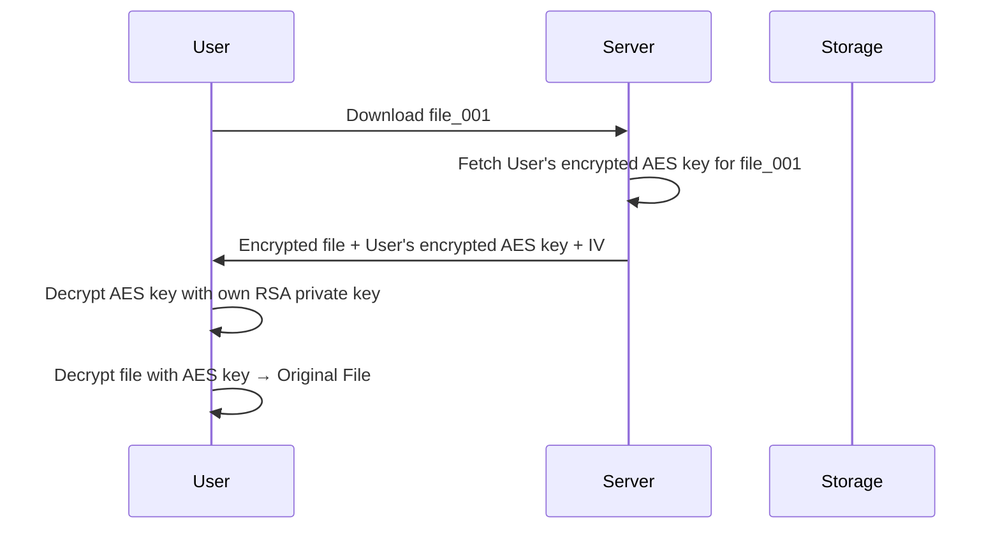
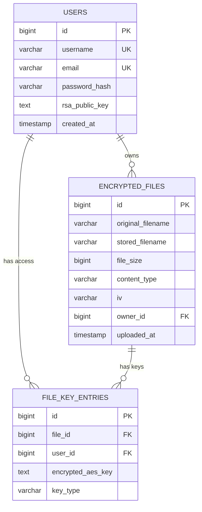

# Cloud-Based File Security System with Hybrid Encryption

A secure cloud storage system using hybrid encryption (AES-256-GCM + RSA-2048) with Java Spring Boot backend and React (Vite) frontend. Features user authentication, encrypted file upload/download, server-side key management, and zero-effort controlled file sharing.

---

## Architecture Overview



---

## Encryption Flow (Server-Side Key Management Model)

### Upload


### Share (Owner clicks "Share" — zero crypto effort)


### Download


> [!IMPORTANT]
> **Client-side decryption**: The user's RSA private key is generated and stored **only in the browser** (using Web Crypto API + IndexedDB). The server **never** sees any user's private key. File decryption happens entirely in the browser.

---

## Tech Stack

| Layer | Technology | Reason |
|---|---|---|
| **Backend** | Java 17 + Spring Boot 3 | User requirement; robust crypto via JCA |
| **Frontend** | React 18 + Vite | Fast, modern, premium UI capabilities |
| **Styling** | Vanilla CSS with custom design system | Rich glassmorphism + dark mode aesthetic |
| **Database** | H2 (dev) / MySQL (prod-ready) | Simple setup, switchable |
| **Auth** | Spring Security + JWT | Stateless, secure |
| **Encryption** | AES-256-GCM + RSA-2048 (JCA) | No external crypto libs needed |
| **Client Crypto** | Web Crypto API | Browser-native RSA key generation + decryption |
| **File Storage** | Local disk (configurable path) | Simple for project demo |

---

## Open Questions

> [!IMPORTANT]
> **Database choice**: I'll use **H2 (embedded database)** for easy setup — no external DB installation needed. It runs in-memory or file-mode. Is this okay, or do you prefer MySQL/PostgreSQL?

> [!IMPORTANT]
> **Client-side private key storage**: User RSA private keys will be generated in the browser and stored in **IndexedDB** (never sent to server). This means if a user clears browser data, they lose access to their encrypted files. Is this acceptable for the project demo, or should we add a private key export/import feature?

---

## Proposed Changes

### Project Structure

```
Cloud PPD-II/
├── backend/                          (Spring Boot project)
│   ├── pom.xml
│   └── src/main/java/com/cloudsecurity/
│       ├── CloudSecurityApplication.java
│       ├── config/
│       │   ├── SecurityConfig.java
│       │   ├── CorsConfig.java
│       │   └── ServerKeyConfig.java
│       ├── controller/
│       │   ├── AuthController.java
│       │   ├── FileController.java
│       │   └── ShareController.java
│       ├── dto/
│       │   ├── AuthRequest.java
│       │   ├── AuthResponse.java
│       │   ├── FileUploadResponse.java
│       │   ├── FileMetadataDto.java
│       │   └── ShareRequest.java
│       ├── model/
│       │   ├── User.java
│       │   ├── EncryptedFile.java
│       │   └── FileKeyEntry.java
│       ├── repository/
│       │   ├── UserRepository.java
│       │   ├── EncryptedFileRepository.java
│       │   └── FileKeyEntryRepository.java
│       ├── security/
│       │   ├── JwtTokenProvider.java
│       │   └── JwtAuthenticationFilter.java
│       ├── service/
│       │   ├── AuthService.java
│       │   ├── CryptoService.java
│       │   ├── FileStorageService.java
│       │   ├── KeyManagementService.java
│       │   └── ShareService.java
│       └── exception/
│           └── GlobalExceptionHandler.java
│   └── src/main/resources/
│       └── application.properties
│
├── frontend/                         (React + Vite project)
│   ├── package.json
│   ├── vite.config.js
│   ├── index.html
│   └── src/
│       ├── main.jsx
│       ├── App.jsx
│       ├── index.css
│       ├── crypto/
│       │   └── cryptoUtils.js          # Web Crypto API: RSA keygen, decrypt, AES decrypt
│       ├── services/
│       │   └── api.js                  # Axios API calls to backend
│       ├── context/
│       │   └── AuthContext.jsx         # JWT + user state management
│       ├── pages/
│       │   ├── LoginPage.jsx
│       │   ├── RegisterPage.jsx
│       │   └── DashboardPage.jsx
│       └── components/
│           ├── Navbar.jsx
│           ├── FileUpload.jsx
│           ├── FileList.jsx
│           ├── FileCard.jsx
│           ├── ShareModal.jsx
│           └── ProtectedRoute.jsx
│
└── Presentation Template SKP-beamer/  (existing)
```

---

### Component 1: Backend — Spring Boot Project Setup

#### [NEW] `backend/pom.xml`
Maven project with dependencies:
- `spring-boot-starter-web` — REST APIs
- `spring-boot-starter-security` — Authentication
- `spring-boot-starter-data-jpa` — Database ORM
- `com.h2database:h2` — Embedded database
- `io.jsonwebtoken:jjwt` — JWT token handling
- `spring-boot-starter-validation` — Input validation

#### [NEW] `backend/src/main/java/.../CloudSecurityApplication.java`
Main Spring Boot application class.

#### [NEW] `backend/src/main/resources/application.properties`
Server port, H2 config, JWT secret, file storage path, server RSA key path.

---

### Component 2: Backend — Authentication

#### [NEW] `model/User.java`
JPA entity: `id`, `username`, `email`, `passwordHash`, `rsaPublicKey` (stored as Base64 string), `createdAt`.

#### [NEW] `repository/UserRepository.java`
Spring Data JPA repository for User entity.

#### [NEW] `dto/AuthRequest.java` & `dto/AuthResponse.java`
Login/Register request body and JWT response with user's public key.

#### [NEW] `service/AuthService.java`
- Register: hash password (BCrypt), store user + their RSA public key (sent from browser during registration)
- Login: validate credentials, return JWT token

#### [NEW] `controller/AuthController.java`
- `POST /api/auth/register` — Register user (receives username, password, RSA public key)
- `POST /api/auth/login` — Login, returns JWT

#### [NEW] `security/JwtTokenProvider.java`
JWT generation (HS256) and validation utility.

#### [NEW] `security/JwtAuthenticationFilter.java`
Spring Security filter that intercepts requests and validates JWT from `Authorization: Bearer <token>` header.

#### [NEW] `config/SecurityConfig.java`
Spring Security config — permit auth endpoints, protect everything else with JWT filter.

---

### Component 3: Backend — Encryption Engine

#### [NEW] `service/CryptoService.java`
Core encryption service using Java Cryptography Architecture (JCA):
- `generateAESKey()` → 256-bit AES key using `KeyGenerator`
- `encryptFileAES(byte[] data, SecretKey key)` → encrypted bytes + IV (AES-256-GCM, 128-bit tag)
- `decryptFileAES(byte[] encrypted, SecretKey key, byte[] iv)` → original bytes
- `encryptAESKeyWithRSA(SecretKey aesKey, PublicKey rsaPub)` → RSA-OAEP encrypted key
- `decryptAESKeyWithRSA(byte[] encryptedKey, PrivateKey rsaPriv)` → SecretKey

#### [NEW] `config/ServerKeyConfig.java`
- On startup: loads or generates the **server's RSA-2048 key pair**
- Stored in a Java KeyStore file (`.p12`) on disk
- Provides `getServerPublicKey()` and `getServerPrivateKey()` methods

#### [NEW] `service/KeyManagementService.java`
- `wrapKeyForUser(SecretKey aesKey, String userPublicKeyBase64)` → encrypted AES key for a specific user
- `wrapKeyForServer(SecretKey aesKey)` → encrypted AES key with server's public key
- `unwrapServerKey(byte[] encryptedKey)` → recover plaintext AES key using server's private key

---

### Component 4: Backend — File Upload/Download

#### [NEW] `model/EncryptedFile.java`
JPA entity: `id`, `originalFilename`, `storedFilename` (UUID), `fileSize`, `contentType`, `iv` (Base64), `ownerId`, `uploadedAt`.

#### [NEW] `model/FileKeyEntry.java`
**The Key Envelope Table**: `id`, `fileId`, `userId`, `encryptedAESKey` (Base64), `keyType` (OWNER / SERVER / SHARED).

#### [NEW] `repository/EncryptedFileRepository.java` & `repository/FileKeyEntryRepository.java`

#### [NEW] `service/FileStorageService.java`
- `uploadFile(MultipartFile, userId)`:
  1. Generate AES key
  2. Encrypt file bytes with AES-256-GCM → get ciphertext + IV
  3. Encrypt AES key with owner's RSA public key → store as OWNER key entry
  4. Encrypt AES key with server's RSA public key → store as SERVER key entry
  5. Save encrypted file to disk, metadata + key entries to DB
- `downloadFile(fileId, userId)`:
  1. Verify user has a key entry for this file
  2. Return encrypted file bytes + user's encrypted AES key + IV
- `getMyFiles(userId)` — list files owned by user
- `getSharedWithMe(userId)` — list files shared with user

#### [NEW] `controller/FileController.java`
- `POST /api/files/upload` — Multipart file upload
- `GET /api/files/my-files` — List user's own files
- `GET /api/files/shared-with-me` — List files shared with user
- `GET /api/files/download/{fileId}` — Download encrypted file + encrypted key
- `DELETE /api/files/{fileId}` — Delete file (owner only)

---

### Component 5: Backend — File Sharing

#### [NEW] `dto/ShareRequest.java`
Fields: `fileId`, `recipientUsername`.

#### [NEW] `service/ShareService.java`
- `shareFile(fileId, ownerUserId, recipientUsername)`:
  1. Verify caller is the file owner
  2. Fetch SERVER key entry for the file
  3. Decrypt AES key using server's RSA private key
  4. Fetch recipient's RSA public key from DB
  5. Encrypt AES key with recipient's public key
  6. Create new `FileKeyEntry` with type SHARED
- `revokeAccess(fileId, ownerUserId, recipientUsername)`:
  1. Verify caller is the file owner
  2. Delete recipient's `FileKeyEntry`
- `getSharedUsers(fileId)` — list who has access

#### [NEW] `controller/ShareController.java`
- `POST /api/share` — Share file with a user
- `DELETE /api/share` — Revoke access
- `GET /api/share/{fileId}/users` — List shared users

---

### Component 6: Frontend — React + Vite Setup

#### [NEW] `frontend/package.json`, `frontend/vite.config.js`, `frontend/index.html`
Vite project with React 18, configured with API proxy to `localhost:8080`.

---

### Component 7: Frontend — Crypto Module (Web Crypto API)

#### [NEW] `frontend/src/crypto/cryptoUtils.js`
Browser-native cryptography (no external libs):
- `generateRSAKeyPair()` — generates RSA-2048-OAEP key pair using `window.crypto.subtle`
- `exportPublicKey(key)` — exports public key as Base64 (SPKI format) to send to server during registration
- `storePrivateKey(key)` — stores private key in IndexedDB (never leaves browser)
- `loadPrivateKey()` — loads private key from IndexedDB
- `decryptAESKey(encryptedKey, privateKey)` — RSA-OAEP decrypt
- `decryptFile(encryptedData, aesKey, iv)` — AES-256-GCM decrypt → original file

---

### Component 8: Frontend — Auth & API

#### [NEW] `frontend/src/context/AuthContext.jsx`
React Context for auth state: JWT token, user info, login/logout functions.

#### [NEW] `frontend/src/services/api.js`
Axios instance with JWT interceptor. API functions for all backend endpoints.

---

### Component 9: Frontend — Pages & Components

#### [NEW] `frontend/src/pages/LoginPage.jsx` & `RegisterPage.jsx`
- Premium dark-mode login/register forms with glassmorphism
- Register: generates RSA key pair in browser, sends public key to server, stores private key in IndexedDB

#### [NEW] `frontend/src/pages/DashboardPage.jsx`
- Main dashboard: file list (my files + shared with me), upload area, search
- Tabbed interface: "My Files" | "Shared With Me"

#### [NEW] `frontend/src/components/FileUpload.jsx`
- Drag-and-drop file upload zone with progress animation

#### [NEW] `frontend/src/components/FileList.jsx` & `FileCard.jsx`
- File cards with name, size, date, type icon, share/download/delete actions
- Subtle hover animations

#### [NEW] `frontend/src/components/ShareModal.jsx`
- Modal to enter recipient username and share
- Shows current shared users with revoke option

#### [NEW] `frontend/src/components/Navbar.jsx`
- App branding, user info, logout

#### [NEW] `frontend/src/components/ProtectedRoute.jsx`
- Redirects unauthenticated users to login

---

### Component 10: Frontend — Styling

#### [NEW] `frontend/src/index.css`
Premium design system:
- **Dark mode** with deep blue/purple gradients
- **Glassmorphism** cards with backdrop blur
- Smooth **micro-animations** (hover effects, transitions, loading states)
- Modern typography (Inter font from Google Fonts)
- Custom CSS properties for consistent theming
- Responsive layout (works on all screen sizes)

---

## Database Schema



---

## Verification Plan

### Automated Tests
```bash
# Backend: Run Spring Boot and verify endpoints
cd backend && mvn spring-boot:run

# Frontend: Run dev server
cd frontend && npm run dev
```

### Manual Verification
1. **Register** two users (User A, User B) → verify RSA key pairs generated in browser
2. **Upload** a file as User A → verify it's stored encrypted on disk
3. **Download** as User A → verify file decrypts correctly in browser to original content
4. **Share** file with User B (one-click) → verify User B sees it in "Shared With Me"
5. **Download** as User B → verify User B can decrypt successfully
6. **Revoke** User B's access → verify User B can no longer access the file
7. **Verify security**: Check that encrypted files on disk are unreadable without keys
